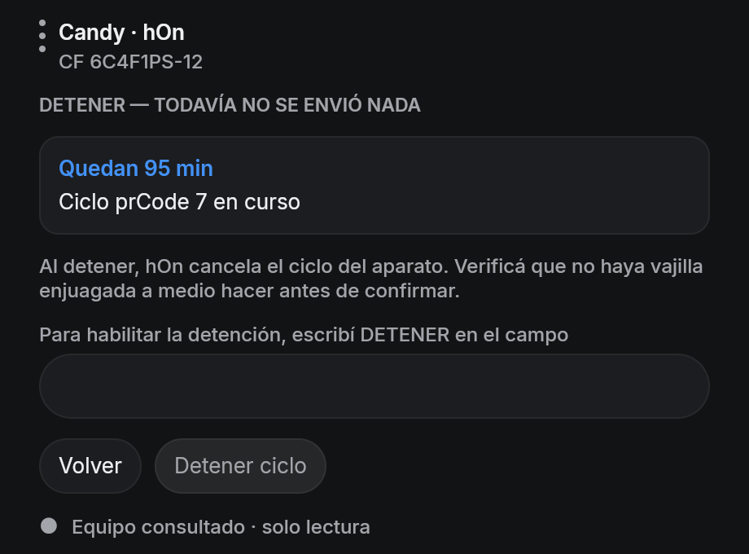

# Candy dishwasher widget

A system tray widget (Rune, native GPU window) for controlling a
**Candy CF 6C4F1PS-12** dishwasher through the hOn API, with a Python
[pyhOn](https://github.com/home-assistant-libs/pyhOn) backend.

## Screenshots

| Home · cycle in progress | Program and remembered options |
|---|---|
|  |  |

| Review (requires `INICIAR`) | Settings | Stop (requires `DETENER`) |
|---|---|---|
|  |  |  |

- Lives in the **system tray**: icon with a menu (Open, Refresh, Settings, Quit).
- Floating **widget-sized** window: height follows the content per screen.
- **Autostart** with the graphical session (systemd --user); closing the window
  keeps the app alive in the tray, `Escape` hides it back there.
- Nothing is sent without typing **`INICIAR`** on the review screen, and stopping
  requires **`DETENER`**; both run on a background task and never block the UI.
- Shows the **remaining time** the appliance reported on its last query,
  discounted by the local clock (no live sync; *Refresh* fetches a fresh value).

## Install and run

```bash
cd hon-dishwasher-tui
./install.sh   # clones Rune (vendor/), creates .venv, builds release, enables autostart
```

`install.sh` drops the service in `~/.config/systemd/user/hon-dishwasher.service`
(wanting `graphical-session.target`). Without autostart, `./run.sh` just opens the
window.

The icon shows up wherever a **tray host** runs: waybar, KDE, most bars (GNOME
needs an extension). Primary click opens the window; secondary click opens the
menu. `Escape` hides the window back to the tray.

### Floating window and sizing

The window declares `app_id "hon-dishwasher"`. On niri, a window rule makes it
float and open near the tray (afterwards niri remembers where you dragged it):

```kdl
window-rule {
    match app-id="^hon-dishwasher$"
    open-floating true
    default-floating-position x=16 y=16 relative-to="top-right"
}
```

The height follows the **content of each screen** (framework's
`fit_content_height`). To make that work on Wayland the repo carries
`patches/winit-request-inner-size.patch`, applied by `./setup.sh`:

1. winit's `request_inner_size` must not veto the resize over the `tiled` state
   that niri sends for server-side decorations (`prefer-no-csd`).
2. when the resize is client-initiated, niri applies the new geometry without a
   configure; the runtime then takes its own viewport and surface in the same
   step, instead of stretching the last buffer to the new size.

Drag the window by the **three dots** at the top-left (`El::window_drag`), or
use your compositor's own drag (Mod + drag).

## Programs and options: `config/programs.json`

The menu programs are **not hard-coded**: they come from
[`config/programs.json`](config/programs.json), the base and default example:

```json
{
  "target": { "applianceType": "DW", "model": "CF 6C4F1PS-12" },
  "programs": [
    {
      "id": "intensive",
      "label": "Intensivo",
      "aliases": ["intensive", "intensivo"],
      "required": [
        { "key": "intensive", "label": "Intensivo+" },
        { "key": "extraDry", "label": "Extra Dry" },
        { "key": "openDoor", "label": "Smart Door" }
      ],
      "basket": true
    }
  ]
}
```

What each field means:

- **`target`**: appliance type (`DW`, `WM`, `OV`...) and model (or part of the
  name) to control.
- **`id`**: internal identifier (`[a-z0-9_-]+`).
- **`label`**: name shown in the app.
- **`aliases`**: how the program is called in the API schema. The backend
  compares the normalized names of `startProgram`'s categories against these
  aliases; the **first declared alias wins** (the schema may carry localized
  variants of the same program, e.g. `intensive` and `Intensivo`). If none
  matches, the program shows as unavailable (nothing is guessed).
- **`required`**: options **sent with that program**, each with a remembered
  switch (default ON, persisted per option). A disabled option is sent
  explicitly as `0`; if the schema pins it to `1`, the program shows as
  unavailable. **Basket (half load) is never remembered**: it starts at
  "no half load" every time.
- **`basket`**: `true` enables half load (upper/lower basket) **only if** the
  schema exposes settable `diverterLevel` (1/2) and `halfLoad` (0/1) for that
  program.

### Generating new options

1. Inspect the appliance's real schema (read-only, sends nothing):

   ```bash
   .venv/bin/python src/backend.py inspect | jq .
   .venv/bin/python scripts/schema.py attributes   # raw appliance parameters
   ```

   Under `profiles → <program> → required` each option reports
   `supported`/`pinned`/`enabled`, and `basket → choices` lists the available
   half loads. `startProgram`'s categories with their parameters show which
   `key`s exist (`extraDry`, `openDoor`, `halfLoad`, `diverterLevel`, ...).

2. Add an object to `programs` with `id`, `label`, `aliases` (one of them must
   match an API category) and its `required` list.

3. Check it loads: `python -m unittest discover -s tests` (21 tests, including
   the config format ones).

The same mechanism carries the app to **other appliances**: change `target`,
and whatever programs/options the JSON declares — the generic engine resolves
availability, half load and sending against the live schema. The backend CLI
(JSON ops over stdin/stdout) is meant to be reusable by other front-ends, such
as a mobile app.

### Configurable default menu

The repo's default menu can be overridden: if
`~/.config/hon-dishwasher/programs.json` exists, it is used instead of the
repo's JSON. Add, remove or reorder programs there without touching the
project. If the override has a format error, the app reports the exact reason
and never guesses.

## Security

- Local credentials: the password goes to the **system keyring**
  (`secret-tool`/libsecret); only the email is stored on disk
  (`~/.config/hon-dishwasher/config.json`, 0600).
- The password travels over the backend's **stdin**; never argv, never the chat,
  never disk.
- Before sending, the backend revalidates: remote control ready, door closed,
  no active cycle, unambiguous program and actually settable options. Any
  failed condition aborts.

## Layout

```
src/main.rs     Rune app: tray, autostart, background tasks, INICIAR/DETENER gates
src/ui.rs       The 5 screens (home, program, review, settings, stop)
src/state.rs    App state, per-screen sizing, countdown
src/model.rs    serde types for the backend's JSON
src/backend.rs  Python subprocess → JSON bridge
src/backend.py  pyhOn: generic schema engine, keyring, start/stop/inspect
config/programs.json   Default menu (base example, extensible)
scripts/schema.py      Dumps startProgram / appliance attributes (read-only)
tests/          Backend tests (21)
vendor/rune/    Framework clone (created by ./setup.sh)
patches/        Wayland fixes applied to the vendored winit + Rune
```

## Development

Headless scenes to verify the UI without a real appliance (sample data, they
send nothing):

```bash
cargo run -- --snap screenshots/home.png --scene sample --at 1.0 --size 460x389
```

Scenes: `sample`, `cycle`, `profile`, `review`, `config`, `config-typed`, `stop`.

```bash
.venv/bin/python -m unittest discover -s tests -v   # backend
cargo test                                          # framework (vendor)
```

## License

[MIT](LICENSE)

## Windows support

The window, tray icon and render run on Windows out of the box (Rune targets
wgpu/DX12 and `Shell_NotifyIcon`). The backend port is included:

- credentials go to the **Windows Credential Manager** through the `keyring`
  package (Linux keeps `secret-tool` when present);
- configuration lives under **`%APPDATA%\hon-dishwasher`**;
- the venv locator accepts `.venv\Scripts\python.exe`;
- `run.bat` opens the window; autostart: put a shortcut to it in
  `shell:startup`.

Not yet packaged as an installer or a tray-only Windows build variant — the
Linux `install.sh` flow is the polished one. Untested on real Windows: it is
the mechanical port, CI for Windows is welcome.
