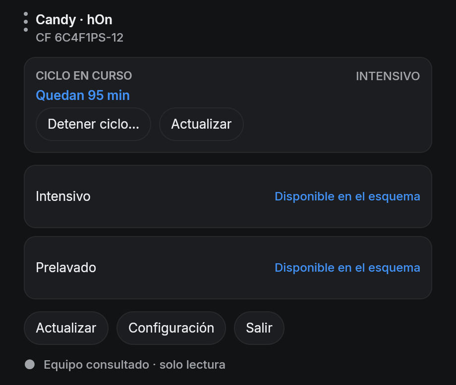
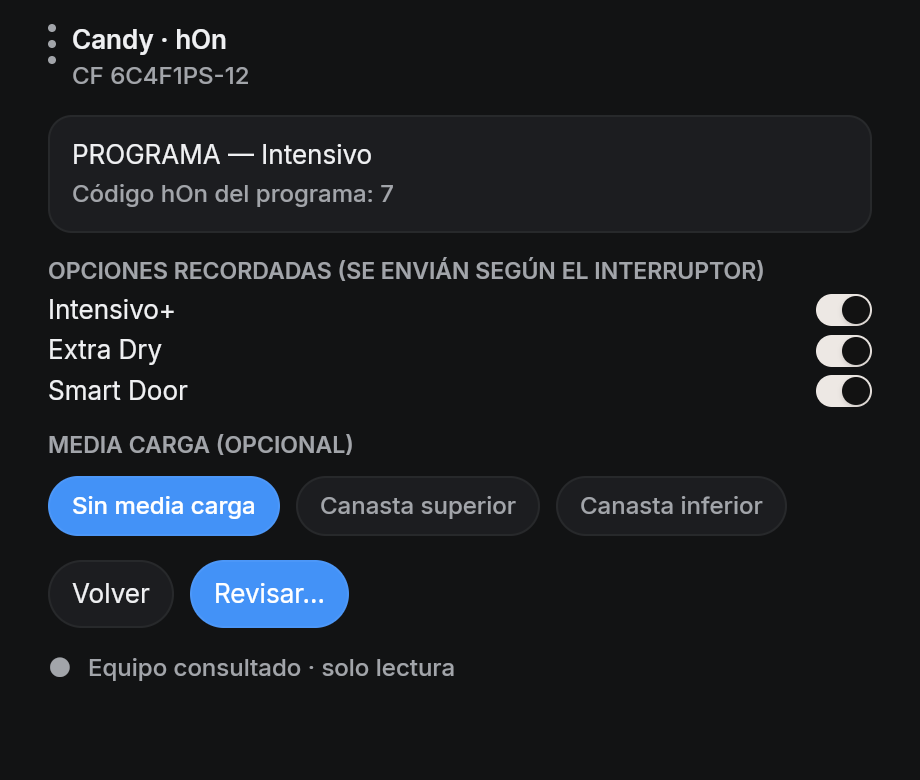
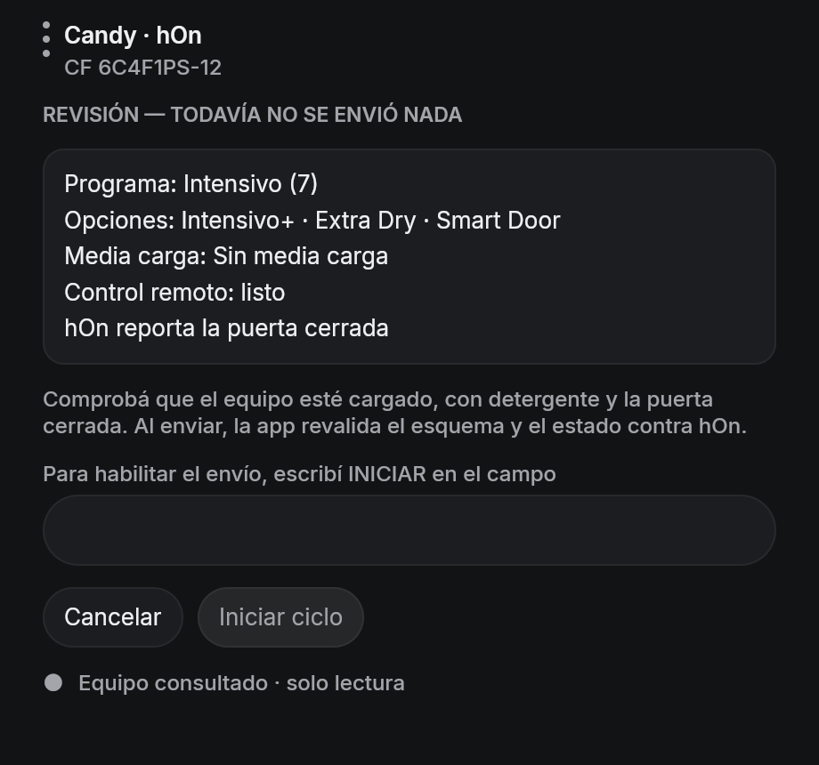
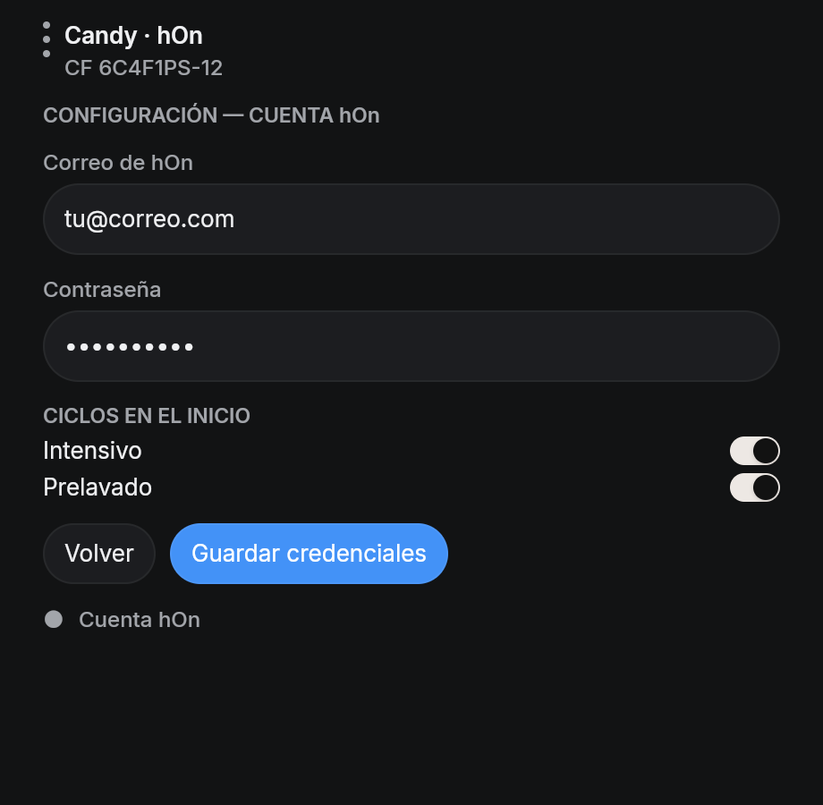

# Candy dishwasher widget

Widget de bandeja (Rune, ventana GPU nativa) para controlar un lavavajillas
**Candy CF 6C4F1PS-12** vía la API de hOn, con el backend Python [pyhOn](https://github.com/home-assistant-libs/pyhOn).

## Capturas

| Inicio · ciclo en curso | Programa y opciones recordadas |
|---|---|
|  |  |

| Revisión (requiere `INICIAR`) | Configuración | Detener (requiere `DETENER`) |
|---|---|---|
|  |  |  |

- Vive en la **bandeja del sistema**: icono con menú (Abrir, Actualizar, Configuración, Salir).
- Ventana flotante **tipo widget**: altura por pantalla (se arrastra por los tres puntos ⋮).
- **Autoinicio** con la sesión gráfica (systemd --user); cerrar la ventana no apaga la app.
- Ningún ciclo se envía sin escribir **`INICIAR`** en la pantalla de revisión, y detener
  exige **`DETENER`**; ambas van en tarea de fondo y nunca bloquean la interfaz.
- Muestra el **tiempo restante** que el aparato reporta en cada consulta, descontado por
  el reloj local (sin sincronía en vivo; `Actualizar` trae un valor fresco).

## Instalar y ejecutar

```bash
cd hon-dishwasher-tui
./install.sh   # clona Rune (vendor/), crea .venv, compila en release y activa el autoinicio
```

`install.sh` deja el servicio en `~/.config/systemd/user/hon-dishwasher.service`
(queriendo `graphical-session.target`). Sin autoinicio, `./run.sh` abre solo la ventana.

El icono aparece donde haya **tray host**: waybar, KDE, la mayoría de las barras
(GNOME necesita una extensión). Clic primario abre la ventana; secundario, el menú.
**Escape** esconde la ventana de vuelta al tray (la app sigue viva en la bandeja).

### Ventana flotante y tamaño

La ventana se declara con `app_id "hon-dishwasher"`. En niri conviene una regla que la
haga flotar y abrir cerca de la bandeja (con esta regla niri la abre arriba a la derecha;
después recuerda la posición que le des arrastrándola):

```kdl
window-rule {
    match app-id="^hon-dishwasher$"
    open-floating true
    default-floating-position x=16 y=16 relative-to="top-right"
}
```

El tamaño se ajusta **por pantalla** (Inicio 320, programa 390, revisión 430,
configuración 365 de alto): Wayland no deja a winit redimensionarse a sí mismo con los
estados del compositor, así que la app pide el alto por IPC de niri
(`niri msg action set-window-height --id …`). Sin niri, queda el tamaño fijo inicial.
Para arrastrar la ventana, agarrala por los **tres puntos (⋮)** de la esquina superior
izquierda, o usá el drag de niri (Mod + arrastrar).

## Programas y opciones: `config/programs.json`

Los programas del menú **no están atados en el código**: salen de
[`config/programs.json`](config/programs.json), que es la base y el ejemplo por defecto:

```json
{
  "target": { "applianceType": "DW", "model": "CF 6C4F1PS-12" },
  "programs": [
    {
      "id": "intensive",
      "label": "Intensivo",
      "aliases": ["intensive", "intensivo"],
      "required": [
        { "key": "intensive", "label": "Intensivo+" },
        { "key": "extraDry", "label": "Extra Dry" },
        { "key": "openDoor", "label": "Smart Door" }
      ],
      "basket": true
    }
  ]
}
```

Qué significa cada campo:

- **`target`**: tipo de aparato (`DW`, `WM`, `OV`...) y modelo (o parte del nombre) a controlar.
- **`id`**: identificador interno (`[a-z0-9_-]+`).
- **`label`**: nombre visible en la app.
- **`aliases`**: cómo se llama ese programa en el esquema del API. El backend compara los
  nombres normalizados de las categorías de `startProgram` contra estos alias; si no hay
  exactamente una coincidencia, el programa se marca como no disponible (nunca se adivina).
- **`required`**: opciones que **siempre se envían activadas** con ese programa. `key` es el
  nombre del parámetro en el esquema (`extraDry`, `openDoor`, ...). Si el esquema actual no
  expone o no acepta una opción, el programa se marca no disponible y no se puede enviar.
- **`basket`**: `true` habilita media carga (superior/inferior) **solo si** el esquema expone
  `diverterLevel` (1/2) y `halfLoad` (0/1) seteables para ese programa.

### Cómo generar opciones nuevas

1. Consultá el esquema real de tu aparato (solo lectura, sin enviar nada):

   ```bash
   .venv/bin/python src/backend.py inspect | jq .
   ```

   En `profiles → <programa> → required` ves cada opción con `supported`/`pinned`, y en
   `basket → choices` las medias carga disponibles. Las categorías de `startProgram` con sus
   parámetros muestran qué `key`s existen (`extraDry`, `openDoor`, `halfLoad`, `diverterLevel`...).

2. Agregá un objeto a `programs` con `id`, `label`, `aliases` (uno de ellos debe matchear la
   categoría del API) y su lista de `required`.

3. Validá que cargue: `python -m unittest discover -s tests` (13 pruebas, incluidas las del
   formato de configuración).

Con ese mecanismo la app se puede llevar a **otros usos**: otro lavavajillas (cambiar
`target`), o cualquier aparato del mismo ecosistema hOn (lavadora `WM`, horno `OV`, ...):
todo lo que cambia es el `target` y los programas/opciones del JSON; el motor genérico
resuelve disponibilidad, medio de carga y envío contra el esquema vivo.

### Menú por defecto configurable

El menú por defecto del repo se puede dejar **en configuración**: si existe
`~/.config/hon-dishwasher/programs.json`, se usa en lugar del JSON del repo. Ahí podés
agregar, quitar o reordenar programas sin tocar el proyecto. Si el override tiene un error
de formato, la app lo reporta con el motivo exacto y no adivina.

## Seguridad

- Credenciales locales: la contraseña va al **keyring del sistema** (`secret-tool`/libsecret);
  en disco queda únicamente el correo (`~/.config/hon-dishwasher/config.json`, 0600).
- La contraseña viaja por **stdin** del backend; nunca por argv, ni por el chat, ni a disco.
- Antes de enviar, el backend revalida: control remoto listo, puerta cerrada, sin ciclo activo,
  programa inequívoco y opciones realmente seteables. Cualquier condición fallida aborta.

## Estructura

```
src/main.rs     App Rune: tray, autoinicio, tareas de fondo, guarda INICIAR
src/ui.rs       Las 4 pantallas (inicio, programa, revisión, configuración)
src/state.rs    Estado de la app
src/model.rs    Tipos serde del JSON del backend
src/backend.rs  Subprocess Python → JSON
src/backend.py  pyhOn: esquema genérico, keyring, inicio/consulta
config/programs.json   Menú por defecto (ejemplo base, extensible)
tests/          Pruebas del backend (13)
vendor/rune/    Clon del framework (se crea con ./setup.sh)
```

## Desarrollo

Escenas headless para verificar UI sin aparato real (datos de ejemplo, nunca envían nada):

```bash
cargo run -- --snap snapshots/home.png --scene sample --at 1.0 --size 400x620
```

Escenas: `sample`, `profile`, `review`, `config`, `config-typed`.

```bash
.venv/bin/python -m unittest discover -s tests -v   # backend
cargo test                                          # framework (vendor)
```

## Licencia

[MIT](LICENSE)
